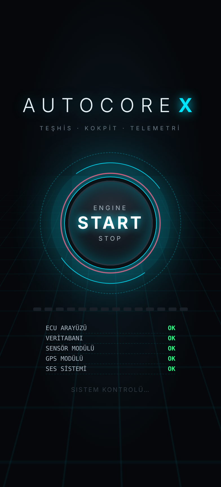
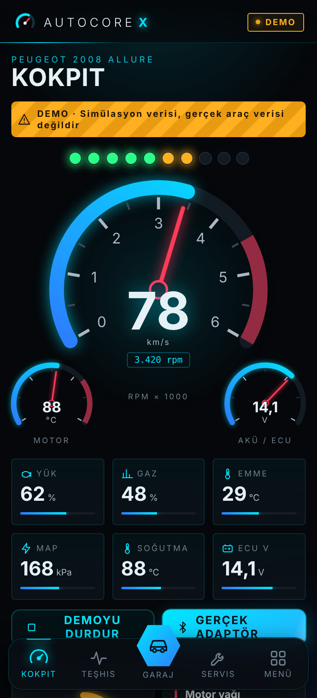

# AutoCore X 🚗

**Android için çevrimdışı araç teşhis ve bakım asistanı.** Canlı OBD-II kokpit, arıza kodu okuma, bakım ve yakıt takibi, GPS yolculuk kaydı ve PDF araç sağlık raporu, tek uygulamada.

<p align="center">
  
  &nbsp;&nbsp;
  
</p>
<p align="center"><sub>Arayüz önizlemesi · Kokpit ekranındaki değerler DEMO simülasyonudur</sub></p>

> ⚠️ **Yasal bilgilendirme:** Bu proje, kişisel portfolyo amacıyla geliştirilmiş bağımsız bir yazılımdır. Herhangi bir araç üreticisi, distribütör veya servis ağının resmî ürünü değildir ve onlarla bağlantısı yoktur. Arıza kodu açıklamaları ve sağlık skoru **yalnızca bilgilendirme amaçlıdır**, kesin teşhis yerine geçmez. DEMO etiketli tüm veriler simülasyondur. OBD işlemleri **salt okunurdur**: araca komut yazılmaz, arıza kodu silinmez. Sürüş sırasında kullanmayın. Ticari amaç taşımaz.

## ✨ Özellikler

| Modül | Ne yapar |
|---|---|
| 🎛️ **Kokpit** | 240° animasyonlu devir göstergesi, vites ışıkları; hız, motor sıcaklığı, akü/ECU voltajı, yük, gaz, emme sıcaklığı, manifold basıncı |
| 🔌 **OBD-II** | ELM327 (klasik Bluetooth / SPP) ile bağlantı, desteklenen PID sorgusu, canlı okuma, bağlantı günlüğü |
| 🧪 **Demo modu** | Adaptör olmadan, açıkça **DEMO** etiketli simülasyon |
| ⚠️ **Teşhis** | Mod 03 arıza kodu okuma, motor arıza lambası (MIL) durumu, 77 kodluk Türkçe sözlük, kod sorgulama, tarama geçmişi |
| 🚘 **Garaj** | Birden fazla araç, fotoğraf; şasi numarası Android Keystore korumalı SecureStorage'da |
| 🔧 **Bakım** | 13 bakım türü, sonraki km/tarih önerisi, geciken / yaklaşan bakım uyarısı ve bildirim, fatura fotoğrafı |
| ⛽ **Yakıt** | Depo-full yöntemiyle L/100 km, 100 km maliyeti, aylık / yıllık gider, 6 aylık grafik |
| 📍 **Yolculuk** | GPS ile mesafe, süre, ortalama / maksimum hız, çevrimdışı rota çizimi |
| 📄 **Rapor** | PDF araç sağlık raporu oluşturma ve paylaşma |
| 🔊 **Deneyim** | "Engine Start" açılışı, Web Audio ile anlık üretilen ses efektleri, titreşim, animasyonlar |

## 🛠️ Teknolojiler

`.NET 10` · `.NET MAUI Blazor Hybrid` · `C#` · `Razor` · `SQLite (sqlite-net-pcl)` · `Android Bluetooth RFCOMM` · `MAUI Geolocation` · `Android PdfDocument` · `SecureStorage` · `SVG / CSS animasyon` · `Web Audio API`

## 🧱 Mimari

```
Models/          Veri modelleri (Arac, BakimKaydi, YakitKaydi, Yolculuk, TaramaKaydi)
Services/        Veri (SQLite), Hesap (tüketim, bakım, sağlık skoru), GpsServisi, RaporServisi, Efekt, Cihaz
Services/Obd/    ObdServisi (ELM327 protokolü + demo), BluetoothObd (SPP), DtcSozluk (arıza kodları)
Components/      Sayfalar: Kokpit, Teşhis, Garaj, Bakım, Yakıt, Yolculuk, Rapor, OBD, Ayarlar + ortak bileşenler
wwwroot/         Tema (acx.css), ses sentezi ve dokunma efektleri (acx.js)
```

- **Çevrimdışı:** Tüm veriler telefondaki SQLite veritabanında; hesap ve internet gerekmez.
- **Salt okunur OBD:** Yalnızca Mod 01 (canlı veri) ve Mod 03 (arıza kodu okuma) kullanılır.
- **Dürüst veri:** Desteklenmeyen sensör "DESTEKLENMİYOR", bağlantı yoksa "VERİ YOK" yazar; tahmin gösterilmez.

## 🚀 Derleme

```bash
dotnet publish -f net10.0-android -c Release -p:AndroidPackageFormat=apk
```

Gereksinimler: Visual Studio 2026, .NET 10 SDK, .NET MAUI Android iş yükü.

## 📌 Durum

- Sürüm 1.0
- 🧪 Gerçek ELM327 bağlantısı yazıldı, **henüz gerçek araçta test edilmedi**
- ❌ Yalnızca BLE (Bluetooth Low Energy) çalışan adaptörler bu sürümde desteklenmiyor

APK, talep üzerine paylaşılmaktadır.

---

Geliştiren: **Furkan Baykal** · Yazılım Mühendisi
